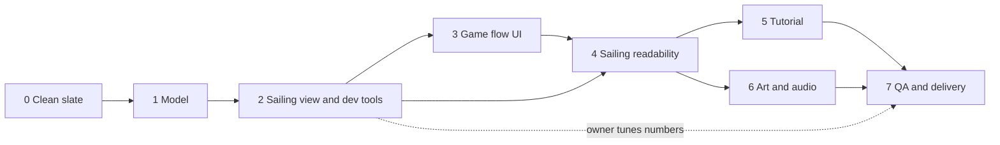

# Lodní fond – implementation plan

This document is the **work order** for implementing the minigame "Lodní fond" (Ship Fund). It is written so that a developer
(or an AI agent) with no knowledge of earlier discussions can build the game from it. It contains **what to keep, what to delete,
what to build, in which order, and when each step is done**.

## 0. How to use this document

| Document | Role | Language |
|---|---|---|
| [specification.md](specification.md) (revision 6) | **Authoritative game design**: rules, economy, formulas, texts, targets. Referenced below as "spec 4.2" = chapter 4.2. | Czech |
| [grafika.md](grafika.md) | **Binding graphics manual**: palette tokens, shapes, characters, state icons, screens. | Czech |
| this plan | **How and in what order to build it**, file disposition, module contracts, config schema, acceptance criteria. | English |
| [../universal-specification.md](../universal-specification.md), [../protokol.md](../protokol.md), [../navod-pro-autory.md](../navod-pro-autory.md) | Platform rules (iframe protocol, author checklist). Apply to every minigame. | Czech |

Rules of precedence: game rules and numbers → spec; look and feel → `grafika.md`; process and structure → this plan. If this plan and
the spec disagree on a game rule, **the spec wins** and the discrepancy is reported (add it to the spec's open questions, do not silently choose).
UI texts are Czech (neutral address, e.g. "Nastav pojistné"); code, identifiers and comments are English.

**Read first:** spec chapters 1–6 (game), then chapter 7 (dev tooling, which is as important as the game), then `grafika.md`.

### The game in ten lines

1. The player manages a fleet of 30 small Viking merchant ships (range 10–60). Each ship is its own small firm; the **fund is all ships of the fleet**.
2. A round = **prepare → sail → evaluate**. 5 rounds by default, preceded by an unscored tutorial.
3. Preparation: the player sets the **premium per ship** `p ∈ [0, c]`. The round budget `c·N` is split into fund (`p·N`) and cargo (`(c−p)·N`). **There is no free cash.**
4. Sailing: the player does **not steer a ship**. They blow **wind gusts** (↑/↓ keys, or a swipe) that push the whole fleet sideways by roughly 0.4 of the track width.
   Every ship reacts a little differently (sail sensitivity, delay, noise, personal edge limit), so the fleet always has a spread.
5. The track is a grid of 3 lanes × rows. Obstacles (pirates, kraken, storm) block some lanes of a row and leave a passage. Several rows form a **formation**
   whose passage moves, so the player must change lane in time. A passive fleet nearly always sinks; even a perfect player loses some ships.
6. A ship whose centre is in a blocked cell when the row passes is wrecked. The fund repairs wrecked ships (`V` gold each); unaffordable ones are lost forever.
   Money left in the fund returns to profit but did not earn as cargo; delivered cargo sells for `m`× its cost.
7. Before each round the player sees **which obstacles and how many rows** (not the exact map) and a **survival statistics card**: low and high prior estimate
   per obstacle type plus the observed survival from earlier rounds. Total survival is simply the **product** over all rows.
   Expected damage per ship ≈ `(1 − S)·V`; the player sets the premium from that (plus a margin).
8. Score: `T = Σ profit + (N_end − N_0)·shipValue`, `successRate = clamp(T / T_ref, 0, 1)`. No extra weights or terms.
9. Retry: 3 per game; a retry **regenerates the track** and **only the new attempt counts**, even if worse (a warning dialog says so).
10. **All numbers are starting points.** They are tuned by a human in the dev playground (spec 7). Building that tool early is part of the job.

## 1. Non-negotiable constraints

- Platform: iframe minigame, protocol v1 in `src/minihra-protokol.ts` (copied, never edited). Exactly one `FINISH`. Works without `level`/`payload`.
  Standalone: `/?level=2&payload={"rounds":3}`. Phone portrait 360–430 px **and** desktop landscape; no horizontal scroll; buttons ≥ 44×44 px.
- **No** `localStorage`, cookies, `alert()`, `confirm()`, remote assets, or new runtime dependencies. All art is SVG/Canvas drawn from code.
- Sound only after the first touch; game fully playable muted; every sound has a use. `prefers-reduced-motion` disables shake and long animations.
- Simulation is frame-rate independent: fixed 60 Hz step, interpolated rendering.
- **No bots, no autopilot, no AI players** anywhere in `src/`, `dev/` or `scripts/` (spec 3.1, 7). The tutorial is fully player-controlled.
  Tests under `test/` may use fixed, hand-written gust schedules as fixtures.
- Keep it simple: no flagship, no cross-currents, no hidden hazards, no carried-over cash, no extra score terms, no route choice (spec 5.9 is out of scope).
- Performance: track generation < 5 ms; 60 ships at 60 fps on a mid-range phone; `npm test` < ~10 s.
- Pure game logic in `src/model/` has **no DOM or React imports** (tested with Node, reused by the dev tools).

## 2. Technical decisions

| Area | Decision |
|---|---|
| Stack | React 18.3.1, TypeScript 5.6.3, Vite 7.3.7, exact pins, `.npmrc` as in `skladani_karty`. No new dependencies. |
| Sailing rendering | Canvas 2D, sprites pre-rendered to offscreen canvases from the SVG paths in `src/art/` |
| UI screens | React (prepare, evaluate, summary, tutorial overlays, dialogs) |
| Game loop | `requestAnimationFrame` + fixed-step accumulator (`src/engine/loop.ts`) |
| Randomness | Seeded mulberry32 + `hash32` (`src/model/rng.ts`). Same seed + same gust schedule ⇒ identical result. |
| Coordinates | Track coordinates: lateral `x ∈ [0, 1]` (0 = top/left edge) and time `t` in seconds at constant speed. Renderer maps to screen by orientation (landscape: left→right; portrait: bottom→top). |
| Tests | `node --test` (Node 24, TypeScript type stripping). Node is at `..\node-v24.22.0-win-x64` and must be on `PATH` (`$env:PATH = "$PWD\..\node-v24.22.0-win-x64;$env:PATH"`). |
| Imports | `src/model/*` and `src/engine/loop.ts` use explicit `.ts` extensions (Node-testable); React files import without extension. |

## 3. Starting point: clean slate

The folder still contains an implementation of an **older, different design** (steering a flagship, `startGold`, bots, semaphore, 100 ships). The new design shares almost no
logic or UI with it (about 15 % of the old lines would survive), so **the old code is deleted, not adapted**. Editing it in place would leave half-converted code with
same-named files that mean different things (`economy.ts`, `sail.ts`, `Config`, `RoundRecord`). The old code stays in git history (`b8cf2d9`); **do not use it as a source of rules.**
The spec is the only source of truth.

### 3.1 KEEP (stays in place)

| Path | Note |
|---|---|
| `node_modules/`, `package-lock.json` | The installed packages |
| `package.json` | Keep name, dependencies and pins exactly. Change only `scripts` (below). No new dependencies. |
| `.npmrc`, `.env.example`, `.gitignore` | Supply-chain rules and git ignores (`public/*`, `dist`, `.env.local`) |
| `tsconfig.json` | Keep; add `dev` to `include`. |
| `vite.config.ts` | Keep as is (React plugin only). |
| `specification.md`, `grafika.md`, `implementation-plan.md` | The inputs. Do not edit except as stated in section 0. |

`package.json` scripts after phase 0: `dev` = `vite`, `build` = `tsc --noEmit && vite build`, `preview` = `vite preview`, `test` = `node --test test/*.test.ts`,
`calc` = `node scripts/calc.ts`, `check` = `node scripts/check.ts`. (Remove `balance`.)

### 3.2 COPY from the sibling project `..\skladani_karty`

| From | To | Note |
|---|---|---|
| `src/minihra-protokol.ts` | `src/minihra-protokol.ts` | Never edit. The current copy is byte-identical to the sibling's. |
| `dev/host-test.html` | `dev/host-test.html` | Host simulator (INIT buttons, log). Adjust only the sample payloads to the new fields (`ships`, `capitalPerShip`, `retries`, `rounds`, `tutorial`, `seed`). |

### 3.3 DELETE (everything else)

Delete `src/` (all files), `test/`, `scripts/`, `dev/` (after copying `host-test.html` per 3.2), `game.config.json`, `README.md`, `index.html`, `dist/` if present.
Then create the new files from section 4. Nothing from the old code is ported **except** these four small, well-understood helpers, which are re-created from their descriptions
(the old sources may be read in git history for reference only): the seeded PRNG (mulberry32, `hash32`, `clamp`), the fixed-step accumulator (`FixedStepper`: step 1/60 s, max steps per frame,
interpolation `alpha`, `reset`), the Czech plural helper `lodi(n)` (1 loď, 2–4 lodě, else lodí) and the audio unlock-on-first-touch core.

Lessons from the old code that must be re-implemented in the new one (not copied): reset the accumulator on `visibilitychange`, cap `devicePixelRatio`, `ResizeObserver` for the canvas,
remove every listener on unmount, hold the end of the voyage for ~1 s before evaluation, focus the safe button when a dialog opens, no sound before the first touch.

### 3.4 NEW (everything in section 4)

`index.html` (lang `cs`, viewport meta as in `skladani_karty`, `theme-color` from the new tokens, title "Lodní fond"), `src/main.tsx`, `src/vite-env.d.ts`, `src/App.tsx`, `src/Game.tsx`,
`src/types.ts`, `src/config.ts`, `src/theme.ts`, `src/art/*`, the whole of `src/model/`, `src/engine/`, the screens and components, `src/styles.css` (written from scratch to the `grafika.md` tokens),
`dev/playground.html`, `dev/calculator.html`, `dev/style-guide.html` (+ their ts), `scripts/calc.ts`, `scripts/check.ts`, `test/*.test.ts` and `test/node-shim.d.ts` (a minimal type shim for `node:test`, `node:assert/strict` and JSON imports so that `tsc --noEmit` passes; do not add `@types/node`), `game.config.json` (section 6), `README.md` (section 9).

## 4. Target structure and module contracts

```
lodni_fond/
  package.json, tsconfig.json, vite.config.ts, index.html, .npmrc, .env.example, game.config.json
  dev/
    host-test.html                 (copied from skladani_karty)
    playground.html + playground.ts(x)   spec 7.1 – game + live parameter panel + measurement + record/replay + export
    calculator.html + calculator.ts      spec 7.3 – expected-value calculator page
    style-guide.html                     grafika.md chapter 9 – all shapes, colours, states on one page
  scripts/
    calc.ts                        `npm run calc -- ships=30 premium=8 survive=80 rounds=5` (spec 7.3)
    check.ts                       `npm run check` – automatic targets table (spec 7.4: T1–T4, T10, T11, T14)
  src/
    main.tsx, App.tsx, Game.tsx    state machine + reducer, INIT handling, FINISH
    minihra-protokol.ts            (copied from skladani_karty, never edited)
    config.ts, types.ts, theme.ts
    model/                         pure logic, no DOM/React
      rng.ts                       seeded PRNG, hash32, clamp
      init.ts                      payload/level validation
      economy.ts                   spec 4.1–4.3
      score.ts                     spec 6
      track.ts                     spec 5.4, 5.5, 5.8: catalog, generator, cell geometry, pearls
      ships.ts                     spec 5.3: per-ship traits from the seed
      sail.ts                      spec 5.2, 5.3, 5.5: simulation of one voyage
      stats.ts                     spec 5.6: observed history (pooled)
      forecast.ts                  spec 5.6: s_hi, s_lo, s_obs, products, expected damage
      diagnostics.ts               spec 7.2: score curve, break-even, sensitivity, game distribution
    engine/
      loop.ts                      FixedStepper
      input.ts                     keys + swipe → gust requests
      view.ts                      SailView (canvas host)
      render.ts                    canvas drawing
      audio.ts
    art/                           SVG path data and React components, one definition per shape (grafika.md 9), including the mute/unmute icons
    Prepare.tsx, Sail.tsx, Evaluate.tsx, Summary.tsx, Tutorial.tsx
    FleetRow.tsx, Crates.tsx, StatsCard.tsx, ui.tsx
    styles.css
  test/
    model.test.ts (or several *.test.ts), node-shim.d.ts
```

### 4.1 Contracts (TypeScript sketches; adjust names, keep the responsibilities)

```ts
// types.ts
type Kind = 'pirates' | 'kraken' | 'storm';
type Cell = '.' | 'P' | 'K' | 'S' | 'o';            // spec 5.4 notation
interface Formation { id: string; kind: Kind; rows: string[]; gap: number[]; minLevel: 1 | 2 | 3 } // rows like 'P.P'; gap[i] = seconds before row i+1
interface TrackRow { index: number; t: number; cells: [Cell, Cell, Cell]; kind: Kind; formation: number;
                     pearl?: { x: number }; scripted?: { wrecks: number } /* tutorial finale */ }
interface Track { rows: TrackRow[]; duration: number; counts: Record<Kind, number> }

// track.ts
generateTrack(cfg, level, seed, round, attempt): Track          // deterministic from (seed, level, round, attempt); spec 5.4 generator rules
tutorialTrack(cfg, part: 1 | 2): Track                          // hand-authored rows from config
blockedIntervals(row, cfg): [number, number][]                  // cells + overhang, merged; used by hit test, renderer, forecast
passageWidth(row, cfg): number                                  // widest contiguous free interval (incl. overhang); the "P" of spec 5.6

// ships.ts
makeShips(cfg, level, seed, n): ShipTraits[]                    // k_i (level range), delay_i, tau_i, edge limits lo_i/hi_i, start x_i; index i keeps the same traits across rounds and retries
                                                                // (the surviving fleet uses the first N' indices)

// sail.ts
class Sail {
  constructor(track, ships: ShipTraits[], cfg, level, seed)
  gust(dir: -1 | 1, strength = 1): boolean                      // false while on cooldown; schedules per-ship impulses (delay_i, ε from hash(seed, gustIndex, i))
  step(): void                                                  // one fixed 60 Hz step
  readonly t: number; readonly done: boolean
  readonly ships: { x: number; alive: boolean; wreckedAtRow?: number }[]
  readonly events: SailEvent[]                                  // wreck, pearl, rowPassed
  readonly rows: { kind: Kind; entered: number; survived: number; width: number }[]   // measurement per row (W = 5th–95th percentile of alive x)
  result(): { wrecked: number; pearls: number; rows: ...; gusts: { t: number; dir: -1 | 1; strength: number }[] }
}

// economy.ts (spec 4.2, 4.3)
settleRound(p, N, wrecked, pearls, cfg): { F, K, repaired, lost, unusedRepairs, fundLeft, delivered, revenue, profit, shipsAfter, value, fundStatus }
// stats.ts + forecast.ts (spec 5.6)
addObservation(history, rows): History                          // pooled over all finished attempts, incl. discarded ones
forecast(track, history, cfg, level): { perKind: { kind; rows; sLo; sHi; sObs: number | null; passes: number }[];
                                       S: { lo; hi; obs }; expectedDamage: { lo; hi; obs } }  // all products, no simulation
// score.ts (spec 6)
successRate(totalProfit, N0, Nend, rounds, cfg): number         // clamp(T / T_ref, 0, 1)
```

Design rules for `sail.ts` (spec 5.3; starting values in section 6):
- Gust impulse for ship `i`: `v_i = g · G · k_i · (1 + ε_i)`, applied after `delay_i`; velocity decays exponentially with `τ_i`. Total displacement ≈ `v·τ`, so `G = meanShift / τ_mean`.
- Edge limits: each ship has its own limit in the outer quarter on both sides; approaching it, the speed towards it is scaled down smoothly to 0 and `x` never passes it.
- With no gusts a ship keeps its lateral position (cosmetic sway ±1 % only).
- Row crossing: ship `i` is tested when its own time `t − offset_i` (offset ±0.15 s, seeded) reaches `row.t`. Hit ⇔ `x_i` inside `blockedIntervals(row)`; hit ⇒ wrecked (probability `p = 1`, deterministic). A pearl is collected by any living ship within `pearl.radius` of it at crossing, once.
- `scripted.wrecks = n` (tutorial part 2 only): wreck the `n` ships nearest to the centre at that row regardless of geometry.
- No `Math.random`, no wall-clock time anywhere in the model.

Game state (`Game.tsx` reducer): `phase`, `round`, `attempt`, `ships`, `bank` (sum of profits), `history`, `retriesLeft`, `records[]`, `snapshot` (state at the start of the round,
restored on a confirmed retry; **`history` is not restored**, spec 3.5 and 5.6), `outcome`. Flow: spec 3 state diagram.

## 5. Phases

Each phase ends in a checkable state. **Order matters: the tuning tool comes before the game UI** (spec 7: "developed from the first version").

### Phase 0 – Clean slate and scaffold

Depends on: nothing.

1. Work on a branch. Delete and copy files exactly as in sections 3.1–3.3 (keep the tooling, copy the protocol file and `host-test.html` from `skladani_karty`, delete everything else),
   update the `package.json` scripts and `tsconfig.json`, create `index.html`, `src/main.tsx`, `src/App.tsx` (placeholder), the empty module files with minimal compiling stubs
   (`noUnusedLocals` is on: do not leave the build red between steps).
2. Write the new `types.ts` and `game.config.json` (section 6) and `resolveInit` for the new payload (spec 8).

Done when: `npm run build` and `npm test` pass (`node_modules` is kept, so no reinstall is needed; run `npm ci` only if it is missing); `dev/host-test.html` receives `READY` and the placeholder app accepts `INIT`;
`resolveInit` unit tests cover missing, wrong types, out-of-range and array payload; only the files listed in 3.1–3.4 exist; no reference to bots/semaphore/flagship/`startGold` remains (`grep`).

### Phase 1 – Model (pure logic) with tests

Depends on: phase 0.

1. `economy.ts`, `score.ts` (spec 4.2, 4.3, 6) including the worked example of spec 4.2 (`N=30, c=50, p=8, w=6` ⇒ profit 1 524; `w=3` ⇒ 2 022).
2. `track.ts`: formation catalog (spec 5.4 table, in config), generator (rules: `n = rows.base(level) + ⌊(round−1)/2⌋`, no three same kind in a row, ≥ 2 kinds, ≥ 2 rows blocking the
   middle lane, 3-row formations only from level 2, every row has a passage), `blockedIntervals`, `passageWidth`, pearls (spec 5.8), tutorial tracks.
3. `ships.ts`, `sail.ts` (spec 5.2, 5.3, 5.5) with the cooldown, per-ship delay/noise/edge limit, hit test, per-row measurement.
4. `stats.ts`, `forecast.ts` (spec 5.6, including the worked example: 60 % / 85 % / 71 %).
5. `diagnostics.ts` (spec 7.2): all as **pure functions of the economy parameters and a per-round survival**; exact expected value via dynamic programming over the number of ships
   (binomial wrecks), seeded Monte Carlo only for the `successRate` distribution.

Done when: unit tests (section 7) pass; track generation is < 5 ms; determinism and frame-rate tests pass.

### Phase 2 – Sailing view and dev tools (gate before UI polish)

Depends on: phase 1. There is **one sailing view** (`input.ts`, `view.ts`, `render.ts`) shared by the playground and the game; no second renderer.

1. Core sailing view (spec 5.1, 5.2): keyboard and swipe input with orientation mapping, resize/DPR handling, lookahead (`view.lookahead`), rows drawn as exactly their hit area
   (including overhang), ships as plain flat shapes (art arrives in phase 6), and **debug overlay hooks** used by the playground. Readability features (red ring, warnings, animations) come in phase 4.
2. `dev/playground.html`: spec 7.1 – the sailing view the developer plays, parameter panel (sliders bound to config values, instant effect), formation picker /
   manual rows (`P.P | .P. | P.P`), seed, record/replay of the human's gusts on the same track with changed parameters, "do nothing" run, debug layers
   (lane lines, per-ship limits, `k_i`, `W(t)`), measurement table (per kind: entered/survived, `W`, `S`, share of passes inside `[s_lo, s_hi]`,
   averages by player-level label selected by the human), **Export configuration** (JSON to clipboard).
   *Optional, add only if time allows:* lateral histogram layer, survival per formation, named parameter sets with side-by-side comparison.
3. `dev/calculator.html` and `scripts/calc.ts`: spec 7.3 (one-round breakdown, table over `x`, forecast calculator), both using the same model functions as the game.
4. Diagnostics panel (spec 7.2) in the playground and calculator: score-vs-premium curve, mistake costs, sensitivity table, break-even `x*`, pearl net benefit, game-level `successRate` distribution.
5. `scripts/check.ts`: prints a pass/fail table for the automatically verifiable targets (T1, T2 first two, T3, T4, T10, T11, T14) from spec 7.4 and exits non-zero on failure.
6. Dev files must not be in the production build (`npm run build` output has only `index.html` and its assets); no `localStorage`.

Done when: every slider in spec 7.1 changes behaviour without a restart, record/replay reproduces a run, the calculator reproduces the spec 4.2 example, `npm run check` runs,
and a human can play a round in the playground with both keyboard and swipe.

> **Hand-off point.** Beyond this point the numbers are tuned by a **human** playing in the playground (T5–T9, T11–T13 and spec 7.5). An agent cannot do this. After phase 2 deliver the
> tools, the `npm run check` output with the starting values, and a note listing which targets are failing. Continue with phases 3–6 using the starting values; the owner updates
> `game.config.json` in parallel. Nothing in phases 3–6 may hard-code a tuned number.

### Phase 3 – Game flow UI

Depends on: phases 1 and 2 (the sailing view from phase 2 is plugged in; the game flow can first run with it).

1. `Game.tsx` reducer and screens following the spec 3 diagram: tutorial → prepare → sail → evaluate → (prepare | summary), give-up path, bankrupt path, retry path (spec 3.5 – snapshot restore,
   new `attempt`, remaining retries, discarded-attempt value shown, **RetryDialog with "Ponechat výsledek" focused by default**).
2. `Prepare.tsx` (spec 3.2): obstacle summary (icons × rows), `StatsCard` (spec 5.6, `grafika.md` stats card: low–high range line, observed marker, "z N průjezdů", step-by-step product),
   level-dependent help (spec 5.7: L1 shows S and premium markers, L2 shows S, L3 shows only per-kind stats with the tap-to-multiply helper), premium slider + −/+ buttons (≥ 44 px),
   live fund/cargo preview as crates, "Jak to funguje?" with the four fund rules (spec 2).
3. `Evaluate.tsx` (spec 3.4, 4.3, 3.6): `FleetRow` (green arrived / blue-wrench repaired / grey-cross lost / dashed ghost = unused repair; recoloured in that order), per-obstacle losses,
   fund line with cost of the mistake, revenue, round profit, fund-status dot + sentence, updated statistics, buttons *Další kolo / Zobrazit souhrn*, *Zkusit znovu*, *Vzdát se*.
4. `Summary.tsx` (spec 3.6): table of rounds, total profit, fleet value change, retries used, `successRate` from `score.ts`; **Pokračovat** sends exactly one `FINISH` with the output payload (spec 8).
5. `Crates.tsx` (gold as crates, `goldUnit`, ≤ ~40 crates, legend, partial crate), every visual with an `aria-label` and a text equivalent.

Done when: a full game runs from `INIT` to `FINISH` with the phase 2 sailing view; output `payload` matches spec 8 (including `attempts`, `retriesUsed`, `notPlayed` rounds, `fundStatus`);
a new `INIT` restarts the game; give-up and bankrupt endings work; layout is correct at 360 px in both orientations.

### Phase 4 – Sailing readability and hosting

Depends on: phases 2 and 3. Builds on the sailing view of phase 2.

1. Readability features in `render.ts` / `view.ts`: fleet at ~⅓ from the start, kraken warning shadow 2 s ahead, storm clouds merging over adjacent `S` cells,
   wind streaks and bent sails on a gust, **red ring** on ships that would hit the next row, "doplouvá: X lodí" counter, wreck animation, pearls, end hold (~1 s).
2. Touch tuning of `input.ts` (strength by drag length per spec 5.2, `touch-action: none`, pointer capture) and hold-to-repeat for keys.
3. `Sail.tsx` hosts the canvas, HUD and *Vzdát se*; the pause on `visibilitychange` keeps the fixed-step accumulator correct.

Done when: a round takes 20–30 s, identical seed + identical gust schedule gives identical results at 60 and 144 Hz (simulated), no ship is ever stuck, the track always ends, both orientations are playable,
holding a key behaves per T14.

### Phase 5 – Tutorial

Depends on: phases 3 and 4.

1. Part 1 (always **one ship**, no fund): captions for the gesture over the two easy rows of `tutorial.rows`, then the code appends a full-width impassable row of three pirates ⇒ geometric wreck ⇒ "Konec podnikání" scene (ship turns grey).
2. Part 2 (`tutorial.ships` ships, default 10) sails the **same track** (spec 3.1): "Co kdyby se firmy spojily?", guided preparation (fund rules, one obstacle with a sample statistic, slider default enough for one repair),
   the player sails; the appended final row is a **scripted** kraken (`scripted.wrecks = tutorial.finaleWrecks`, it wrecks only the ship nearest the centre, independent of geometry); evaluation shows the fund repaired it.
3. No retries, nothing scored. `payload.tutorial = false` skips it.

Done when: a first-time player finishes it unaided in about a minute and can say why the fund exists.

### Phase 6 – Art, audio, feel

Depends on: phase 4 (sprites can start earlier).

1. `src/theme.ts` (tokens from `grafika.md` chapter 2, also exported as CSS variables), `src/art/` (each shape once, used by React and by canvas sprites), `dev/style-guide.html` as the visual test page.
2. Ships with faces and 6–8 colour variants, three obstacle characters, pearls, gold crates, state icons (shape **and** colour), fonts with full Czech diacritics (test "ÁČĎÉĚÍŇÓŘŠŤÚŮÝŽ").
3. Audio: waves, gust, hit, coins when the profit is shown, pearl; mute button; shake only when `prefers-reduced-motion` is off.
4. Run the `grafika.md` chapter 10 checklist.

Done when: the style-guide page shows every element, no raster files, audio never plays before the first touch, everything playable muted.

### Phase 7 – QA, docs, delivery

Depends on: all.

1. Author checklist (`../universal-specification.md`, chapter 5) item by item, including a real phone (portrait and landscape) and a 120 Hz device.
2. Tester with: empty payload, `rounds: 500`, wrong types, array payload, immediate give up, repeated `INIT` after `FINISH`, `retries: 0`.
3. Spec 7.5 playtests (owner), including 5 first-time players (spec 7.5 item 8).
4. Update `README.md` (section 9). Security: `VITE_ALLOWED_PARENT_ORIGINS`, CSP `frame-ancestors`, `npm audit`.
5. Delivery to Pavel Zimmermann (GitHub invite, minigame ID, input/output description).

## 6. `game.config.json` (new schema, **starting values to be tuned**)

All tunables live here; the playground edits them and exports the result. Values come from spec 4.1, 5.2–5.8, 6; those marked † are suggestions of this plan, not of the spec.

The block below uses comments and † for explanation only; the real `game.config.json` is plain JSON.

```jsonc
{
  "defaults": { "level": 2, "rounds": 5, "ships": 30, "capitalPerShip": 50, "tutorial": true, "retries": 3 },
  "limits":   { "rounds": [1, 10], "ships": [10, 60], "capitalPerShip": [10, 100], "retries": [0, 10] },
  "economy":  { "repairCost": 40, "cargoMultiplier": 3.0, "shipValue": 200, "pearlValue": 150,
                "profitTargetPerShip": 90, "goldUnit": 100, "surplusUnused": 2 },
  "gust":     { "meanShift": 0.4, "cooldown": 0.5, "noise": 0.15, "delay": [0, 0.25], "tau": 0.6, "tauJitter": 0.15†,
                "strength": [0.6, 1.5], "swipeStandard": 0.25, "softEdge": 0.04† },
  "ships":    { "edgeLimit": [0.03, 0.25], "elasticity": { "stiffness": 20, "damping": 2, "depth": 0.6 }, "startSpread": 0.07, "sway": 0.01, "rowOffset": 0.15, "cohesion": 0,
               "kRange": { "1": [0.8, 1.2], "2": [0.7, 1.3], "3": [0.6, 1.4] } },
  "track":    { "speed": 1, "leadIn": 3†, "leadOut": 2†, "pearlRadius": 0.05,
                "rows": { "base": { "1": 3, "2": 4, "3": 4 }, "growEvery": 2 },
                "overhang": { "pirates": 0, "kraken": 0.03, "storm": 0.05 },
                "p": { "pirates": 1, "kraken": 1, "storm": 1 },
                "gap": { "between": 3.5†, "perLane": 2.5† },
                "maxPearls": 2 },
  "formations": [ { "id": "patrol", "kind": "pirates", "rows": ["P.P"], "gap": [], "minLevel": 1 },
                  { "id": "zigzag", "kind": "pirates", "rows": ["P.P", ".P.", "P.P"], "gap": [2.5, 2.5], "minLevel": 2 }
                  /* … the 7 formations of the spec 5.4 catalog; gap = perLane × lanes to cross, ≥ 1 s margin */ ],
  "forecast": { "wGood": { "1": 0.18†, "2": 0.20†, "3": 0.22† }, "wAverage": { "1": 0.30†, "2": 0.34†, "3": 0.38† } },
  "view":     { "lookahead": 4.5 },
  "tutorial": { "ships": 3, "finaleWrecks": 1, "rows": ["P.P", ".K."] },  /* two easy rows; the final unavoidable row is appended by the code */
  "targets":  { /* T1–T14 thresholds from spec 7.4, read by scripts/check.ts and shown in the playground */ }
}
```

`forecast.wGood/wAverage` are placeholders; they must be replaced by values measured in the playground (spec 5.6). Lane and cell geometry: three lanes of ⅓ width.

## 7. Tests (`npm test`, correctness of the code; < ~10 s)

Tests verify the **code**, not the tuned balance (balance is checked by `npm run check` and by humans, so tuning never breaks the test suite).

- `resolveInit`: defaults, invalid values replaced, unknown fields ignored, array payload ⇒ `INVALID_PAYLOAD`, level fallback, seed handling.
- `economy`: the spec 4.2 examples (1 524 and 2 022), `r = min(w, ⌊F/V⌋)`, lost cargo of wrecked-but-repaired ships, `U` and fund status boundaries (spec 4.3), `p = 0`, `p = c`, bankrupt (`N′ = 0`), integer rounding.
- `score`: `T`, clamp at 0 and 1, give-up at the start ⇒ 0, retry counts only the last attempt.
- `track`: generator rules for 1 000 seeds per level (every row has a passage, ≥ 2 rows block the middle, ≥ 2 kinds, no three of a kind in a row, row count formula,
  3-row formations only at level ≥ 2, ≤ 2 pearls, pearl cell is free), determinism from `(seed, level, round, attempt)`, a retry yields the same row count with different formations,
  `blockedIntervals` with overhang, `passageWidth` examples of spec 5.4 (0.33, 0.30, 0.64, 0.28).
- `sail`: same seed + same gust schedule ⇒ identical result; **frame-rate independence** (feed `FixedStepper` 60/144 Hz frame times, identical results); no gust ⇒ lateral positions unchanged;
  cooldown rejects gusts; gust moves the mean by ≈ `meanShift` and ships by different amounts; edge limits differ per ship and are never exceeded; a hit wrecks, a free cell does not;
  scripted wreck picks the ship nearest the centre; pearl collected once; the track always ends.
- `forecast`/`stats`: the spec 5.6 example (60 %, 85 %, 71 %), pooled observation across attempts, unseen kind ⇒ midpoint, `s_lo ≤ s_hi`.
- `diagnostics`: curve reproduces a hand-computed single-round case, DP expectation agrees with a seeded Monte Carlo within tolerance, break-even is monotonic.
- Game reducer: retry restores ships/bank but not `history`; retries counter decreases only on confirmation; output payload shape.

## 8. Dependencies between phases



## 9. README

Rewrite `README.md` (Czech, same format as `skladani_karty/README.md`): the idea of the game, how to run (`npm ci`, `npm run dev`, `npm run build`, `npm test`, `npm run check`, `npm run calc`),
dev pages (`/dev/playground.html`, `/dev/calculator.html`, `/dev/style-guide.html`, `/dev/host-test.html`), input `payload` (spec 8), output `payload`, `level`, `successRate`, defaults,
where to tune numbers (`game.config.json` + playground export), link to `specification.md` and `grafika.md`.

## 10. Risks

| Risk | Impact | Mitigation |
|---|---|---|
| Gusts are not fun or readable on touch (spec 10) | Core mechanic fails | Prototype in the playground in phase 2; fallback: continuous wind while holding, same statistics |
| Premium optimum is flat; sailing dominates the score (spec 4.4, 6) | Insurance is not a real decision | Diagnostics (7.2) and T11; tune `m`, `V`, `c`, `shipValue`; no extra score terms |
| Formations unreadable or unfair | Frustration | `view.lookahead`, gap ≥ 1 s margin (T13), red ring on endangered ships |
| Statistics too hard to understand | Educational goal missed | Level 1 does the maths; sentences and step-by-step product; test with 5 first-time players |
| Landscape vs. portrait | Poor fit in the host | Orientation-independent logic, both orientations tested; confirm with Pavel |
| Performance | Frame drops | Sprite caching, DPR cap, 60 ships max |
| Tuning workload | Schedule slip | Tools first, all numbers in config, `npm run check` |

## 11. Open items (from spec 10; do not block implementation)

Minigame ID; meaning of `level` in the host game; acceptable game length (6–7 min); tutorial ship count (1 or 3); keep or drop pearls; number of retries; whether the economy-only
score keeps premium estimation important. Record any new open point in the spec instead of deciding silently.

## 12. Definition of done

- Every phase's "Done when" holds; `npm run build`, `npm test` and `npm run check` run clean (check may list targets that still need human tuning, none may be code errors).
- No code or config left from the old design (section 3.3), no bots, no semaphore, no `startGold`.
- The author checklist is satisfied and the README is current.
