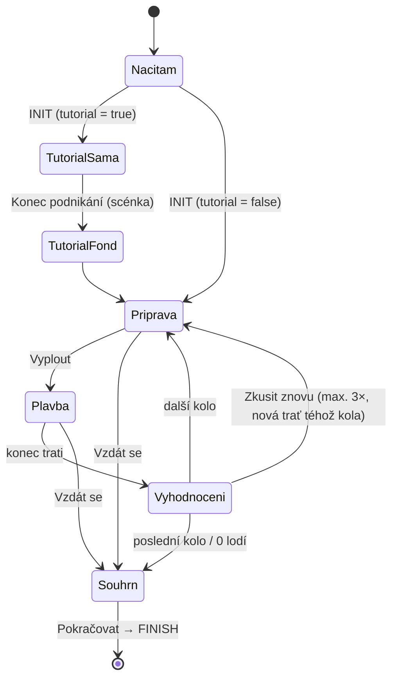

# Lodní fond – specifikace minihry

Minihra do Aktuárské kariérní hry. Obecná pravidla (protokol iframe, designové zásady, kontrolní seznam) jsou v
[`universal-specification.md`](../universal-specification.md) a platí pro tuto hru; tento dokument je popisuje jen tam, kde se
liší nebo je upřesňuje. Stav: upřesněný návrh, revize 6
(skóre = zisk + změna hodnoty flotily, ladění hrou jako klíčová součást, uskupení překážek, statistiky z dřívějších kol).
Vzhled: `grafika.md`.

**Všechna čísla v ekonomice a pohybu jsou výchozí body pro ladění, ne výsledek návrhu.** Správné hodnoty mají vzejít z hraní
ve vývojovém nástroji (kap. 7), který ukáže důsledky změny parametrů.

## 1. Cíl a poselství

Hráč má pochopit princip pojištění jako společného fondu: **každý přispívá malou částkou a z fondu
se pokryjí velké škody těch, koho nehoda postihne.** Hráč se zároveň přesvědčí, že

- bez pojištění může jedna nehoda znamenat konec podnikání (tutoriál to ukáže na jediné lodi),
- **ztracená loď už nevydělává**, takže málo pojistného se vrátí jako ztráta lodí,
- příliš vysoké pojistné se **vrátí do zisku, ale peníze nevydělaly jako zboží**, takže je přeplácení zbytečně drahé,
- **výše pojistného se odvíjí od pravděpodobnosti škody**, kterou lze odhadnout z druhů a počtu překážek a ověřit podle zkušenosti
  z dřívějších kol (statistiky, kap. 5.6).

Hlavní dovedností je odhadnout pojistné. Plavba (foukání větru) ovlivňuje, kolik lodí se ztratí, ale nikdy nezachrání všechny.
Délka hry: cca 6–7 minut (tutoriál cca 1 min + 5 kol po cca 1 min, bez opakování). Texty česky, oslovení neutrální („Nastav pojistné“).

## 2. Příběh a role

Flotilu tvoří **malé obchodní lodě, z nichž každá je samostatná firma** (výchozí 30). **Společný fond** tvoří všechny lodě flotily:
každá do něj přispívá malou částkou, a z fondu se opraví ty, které ztroskotají. Jedna nehoda by samotnou firmu zničila, společně ji
unesou všichni. Hráč je správce flotily: určuje pojistné a z přístavní věže **vyfukuje vítr**, kterým odfukuje lodě z cesty nebezpečí.
Lodě plují samy. Vizuálně vikingský styl, aby hra ladila s brandingem ČSpA.

**Pravidla fondu** (hra je hráči vždy řekne, v tutoriálu, v přípravě a na vyžádání tlačítkem „Jak to funguje?“):
1. Fond tvoří příspěvky všech lodí. Z něj se platí opravy ztroskotaných lodí (`V` zlatých za loď).
2. Co ve fondu zbude, se **vrátí do zisku**. Nic se neztrácí.
3. **Zboží se prodá dráž, než stálo.** Zlatý v nákladu vydělá víc než zlatý ve fondu, takže zbytečné přeplácení vlastně ubírá zisk.
4. **Dáš-li do fondu málo, ztratíš lodě.** Neopravená loď už neveze zboží a nevydělává, takže ubude zisk v dalších kolech.

Peníze na plavbu jsou z příběhu „půjčené na začátku kola“ (kap. 4.2), příběh o jejich původu se nerozvádí.

## 3. Průběh hry



- **Hrací kola (výchozí 5):** příprava → plavba → vyhodnocení. Do dalšího kola se přenáší **počet lodí** a **statistiky překážek**.
  Peníze se nepřenášejí: zisk kola se ukládá do banku a každé kolo začíná novým kapitálem (kap. 4.2).
- **Konec:** po posledním kole, při ztrátě všech lodí (bankrot) nebo po „Vzdát se“ (s potvrzovacím
  oknem v aplikaci, ne `confirm()`). Souhrn (kap. 3.6) a tlačítko **Pokračovat**, které odešle právě jeden `FINISH`.

### 3.1 Tutoriál (kolo 0, nehodnoceno, cca 1 min)

Vysvětluje ovládání větru a pak důvod, proč fond existuje. **Všechno ovládá hráč, žádný autopilot ani bot.** Obě části plují
po téže krátké trati: dvě snadné překážky; v první části navíc závěrečná neprůjezdná překážka.

1. **Jedna loď (`TutorialSama`).** Hráč má **jednu loď** (= svou firmu), bez fondu. Krátké popisky vysvětlí ovládání:
   „Přejeď prstem / stiskni ↑ ↓ a odfoukni loď z cesty.“ Dvě snadné překážky hráč projede sám. Na konci je překážka
   přes celou šířku (tři piráti), které se **nelze vyhnout**. Loď ztroskotá a následuje scénka **Konec podnikání** (loď zešedne):
   „Jedna nehoda a firma je v troskách.“ Loď je **průměrná** (všechny vlastnosti uprostřed rozsahu, vlastní okraj uprostřed), aby překážky
   šlo splnit bez nadání.
2. **Společný fond (`TutorialFond`).** Text: „Co kdyby se firmy spojily?“ Hráč má **deset lodí** (`tutorial.ships`, upřesní testování,
   může být i 1) a krátký průvodce přípravou: **pravidla fondu** (kap. 2), jedna překážka se statistikou (ukázka výpočtu z kap. 5.6)
   a posuvník pojistného (výchozí hodnota stačí na opravu jedné lodě).    Hráč lodě opět ovládá sám. Trať je jen ze dvou snadných překážek a platí na ni běžná pravidla srážek; vyhodnocení ukáže, co fond
      udělal s případnými ztracenými loděmi.

V tutoriálu nejsou opakování a nic z něj se nepočítá do skóre.

### 3.2 Příprava

Hráč vidí:
- stav: počet lodí, celkový zisk v banku, zbývající opakování kola,
- **předpověď** (kap. 5.6): **jaké překážky a kolik řad jich bude** (ikony × počet, ne přesná mapa) a statistiku přežití podle druhu
  překážky: odhad předem (dolní a horní mez) a pozorování z dřívějších kol,
- **výpočet přežití a pojistného** vysvětlený krok za krokem (podle úrovně, kap. 5.7),
- **posuvník pojistného na loď** (celé zlaté, 0 až `c`), který se zastavuje jen na hodnotách, kde fond **pojistí o jednu celou loď víc** než předchozí
  hodnota (nejnižší pojistné pro daný počet oprav; např. 30 lodí: 0, 2, 3, 4, 6, 7, 8, 10 …), tlačítka −/+ (min. 44 × 44 px) posouvají o jednu loď.
  Na posuvníku jsou **značky** odhadů z předpovědi (optimistický, pozorovaný, pesimistický), pokud je úroveň ukazuje,
- živý náhled: „Fond: X zlatých (opraví až Y lodí)“, „Náklad: Z zlatých“ jako bedny zlata (kap. 3.6). Rozpočet je jen fond a náklad,
- tlačítko **Jak to funguje?** s pravidly fondu (kap. 2).

### 3.3 Plavba

Délka 20–30 s podle počtu řad (jedna trať daná seedem). Flotila pluje sama, hráč vyfukuje vítr. Viz kapitola 5.

### 3.4 Vyhodnocení

Postupně se animují řádky, každý s vizualizací podle kap. 3.6:
1. Ztroskotalo X lodí (náklad na nich je ztracen) a **přehled podle překážek** („Piráti: z 30 lodí ztraceny 2“).
2. Fond: Y zlatých → **opraveno O lodí** za O · V zlatých, N lodí navždy ztraceno (fond nestačil), **zbytek fondu se vrací do zisku**.
   Hra **vyčíslí cenu chyby**: u přebytku „ušlý zisk: kdyby tyto peníze jely jako zboží, vydělaly by asi +X zlatých“, u neopravených
   lodí „každá ztracená loď stojí {shipValue} zlatých a další zisk“. Čísla jsou odhad ze skutečného přežití kola.
3. Dovezený náklad × koeficient = výnos (+ perly).
4. **Zisk kola** (kap. 4.2) a do dalšího kola: lodě N′.
5. **Stav fondu** (kap. 4.3), hodnota kola a **aktualizovaná statistika** („Pozorované přežití: piráti 95 %, …“).

Podrobnosti kola jsou v záložkách **Fond**, **Výnos**, **Co kdyby** a **Pozorování**. Záložka **Co kdyby** přepočítá stejné kolo (stejný
počet ztroskotaných lodí a perel) pro každé možné pojistné: graf zisku kola podle pojistného s vyznačenou hráčovou a nejlepší volbou
a oblastí, kde fond nestačí, a tabulka variant (méně / více peněz ve fondu, nejlepší volba, nejmenší fond bez ztrát). Ztracené lodě se
ve Fondu ukazují jako záporná částka.

Hlavním ukazatelem je **řada malých lodí** (kap. 3.6): doplula / opravena / ztracena a „duchové“ pro nevyužité opravy.
Barevná tečka stavu fondu je jen vedlejší doplněk.

Tlačítka: **Další kolo** (u posledního kola nebo bankrotu **Zobrazit souhrn**), **Zkusit znovu**
(kap. 3.5, jen pokud zbývá opakování) a **Vzdát se**. Pokud kolo skončilo bankrotem nebo ztrátou víc než
poloviny lodí, je **Zkusit znovu** zvýrazněno.

### 3.5 Opakování kola (retry)

Hráč má na celou hru omezený počet opakování (výchozí **3**, konfigurace `retries`, vstup `payload.retries`).
Opakování je **sázka, ne druhá šance na totéž**: nový pokus nahradí starý, ať dopadne lépe, nebo hůř.

- Nabízí se na obrazovce vyhodnocení hrací kola (ne v tutoriálu), i po bankrotu a po posledním kole.
  Opakovat lze jen právě vyhodnocené kolo. Je určeno hlavně pro nezvládnutou plavbu.
- Stav (lodě, zisk) se vrátí na začátek kola a hráč se vrací do přípravy. Posuvník je předvolený na poslední
  pojistné, které hráč může změnit.
- **Trať se vygeneruje znovu** (nový seed odvozený z původního seedu, kola a čísla pokusu, tedy pořád deterministicky) se stejným počtem řad,
  ale **jinými uskupeními**, takže se mohou změnit i druhy a počty překážek v předpovědi. Lodě mají stejné plachty.
- **Počítá se výhradně nový pokus.** Dřívější pokus se zahodí, i když byl lepší. Zkušenosti z něj (statistiky překážek) hráči
  zůstávají, protože je viděl.
- Opakování se nepočítá do skóre ani ho nesnižuje. Omezuje ho jen počet a riziko horšího výsledku.
  Zbývající opakování se zobrazují v přípravě, vyhodnocení a souhrnu. Po opakovaném kole vyhodnocení
  krátce ukáže hodnotu zahozeného pokusu.
- **Varování před opakováním:** tlačítko **Zkusit znovu** otevře okno (ne `confirm()`), které říká: „Nový pokus
  nahradí současný výsledek, i když dopadne hůř. Trať bude jiná.“ Zobrazí hodnotu kola současného pokusu, počet zbývajících
  opakování a tlačítka **Zkusit znovu** a **Ponechat výsledek**. Výchozí (zaměřené) je **Ponechat výsledek**.
  Opakování se spotřebuje až po potvrzení.
- Každé opakování se zapíše do výstupního `payload` (`retriesUsed`, `attempts` u kola).

### 3.6 Vizualizace stavu (příprava, vyhodnocení, souhrn)

Čísla doplňují přehledné obrázky, aby hráč viděl poměr a nemusel počítat.

- **Flotila jako řada/mřížka ikon lodí** (1 ikona = 1 loď, při 30 lodích se vejdou do 2 řádků po 15 na šířku 360 px).
  Stavy se liší barvou **i tvarem** (kvůli barvoslepým):
  - zelená loď: doplula,
  - modrá loď s klíčem: ztroskotala, ale fond ji opravil,
  - šedá loď s křížkem: ztroskotala a je navždy ztracena,
  - **čárkovaný „duch“ lodi: oprava, na kterou fond měl, ale nebyla potřeba** (peníze se vrátily do zisku, ale nevydělaly jako zboží).
  Ve vyhodnocení se ikony přebarvují postupně (nejdřív ztroskotané, potom opravené, nakonec duchové).
- **Zlato jako bedny:** 1 bedna = pevná jednotka (`goldUnit`, výchozí 100 zlatých, u velkých částek
  se jednotka zvětší tak, aby bylo nejvýš cca 40 beden; legenda ji vždy uvádí), neúplná bedna je
  částečně zaplněná. Rozpočet kola je **jen fond (modré) a náklad (žluté)**. Ve vyhodnocení bedny výnosu, oprav a zisku.
- **Statistika překážek** (příprava): karta s řádkem na druh překážky (ikona × počet řad, odhad předem jako úsečka od–do,
  pozorování jako značka) a výpočtem celkového přežití (kap. 5.6, `grafika.md`).
- **Souhrn** obsahuje navíc tabulku kol (stav fondu, pojistné, fond, ztraceno lodí, zisk), celkový zisk, hodnotu lodí na konci
  a počet využitých opakování.
- Každá vizualizace má textový ekvivalent (`aria-label`, čísla vedle obrázku) a funguje bez animace
  (`prefers-reduced-motion`). Grafika je SVG, bez rastrových souborů.

## 4. Ekonomika

### 4.1 Parametry (výchozí body pro ladění, viz 4.4 a 7)

| Symbol | Význam | Výchozí bod |
|---|---|---|
| `N` | počet lodí na začátku | 30 (rozsah 10–60) |
| `c` | kapitál na loď a kolo (`capitalPerShip`), tedy největší náklad, který loď unese | 50 zlatých |
| `V` | cena opravy ztroskotané lodě | 40 zlatých |
| `m` | koeficient výnosu nákladu (zboží se prodá dráž, orientačně 2–3×) | 3,0 |
| `shipValue` | hodnota lodě (do změny hodnoty flotily ve skóre) | 200 zlatých |
| `pearlValue` | hodnota perly (musí stát za riziko ztráty lodě) | 150 zlatých |

Parametry žijí v `game.config.json`. Ladí se hrou v hřišti (kap. 7), kalkulátor jen ukazuje důsledky.

### 4.2 Výpočet jednoho kola (bez volné hotovosti)

Na začátku každého kola dostane každá živá loď **kapitál `c`** (příběhově půjčený, vrací se z výnosu) a rozpočet kola je `B = c · N`.
Kapitál je zároveň **největší náklad, který loď unese**, takže nelze naložit všechno na jednu loď. **Hráč jen rozděluje rozpočet mezi fond
a náklad, nic nezůstává stranou.**

- Hráč zvolí pojistné na loď `p ∈ [0, c]`. Fond: `F = p · N`. Náklad: `K = B − F = (c − p) · N`, rozdělený mezi lodě **rovným dílem**.
- `w` = počet ztroskotaných lodí (plavba).
- **Nejdřív opravy z fondu:** opraveno `r = min(w, ⌊F / V⌋)`, platí se `r · V`, ztraceno navždy `L = w − r` (fond nestačil). **Zbytek fondu
  `F − r · V` se vrací do zisku.** Nevyužité opravy `U = ⌊F / V⌋ − r` jsou „duchové“ lodě (kap. 3.6).
- **Teprve potom výnos:** dovezený náklad `K · (N − w) / N` (náklad ztroskotané lodě je ztracen, i když se loď opraví).
  Výnos = `m · dovezený náklad + perly`. Výnos **nelze použít na opravy**.
- **Zisk kola** `π = výnos + (F − r · V) − F = výnos − K − r · V` (vyjde i záporný). Půjčený kapitál se vrací,
  zisk se ukládá do **banku** a do dalšího kola se nepřenáší.
- Další kolo: `N′ = N − w + r`, rozpočet nového kola `c · N′`.
- **Hodnota kola** (pro srovnání pokusů): `π + (N′ − N) · shipValue`.

**Kontrolní příklad** (`m = 3`): `N = 30`, `c = 50` (`B = 1 500`), `p = 8` → `F = 240`, `K = 1 260`. Ztroskotá `w = 6`, fond opraví `r = 6` (za 240),
`N′ = 30`. Dovezeno 1 008 nákladu, výnos 3 024, zisk kola `3 024 − 1 260 − 240 = 1 524`.
**Totéž s `w = 3`:** opraveno 3 za 120, zbytek fondu 120 se vrací, dovezeno 1 134, výnos 3 402, zisk `3 402 − 1 260 − 120 = 2 022`.

### 4.3 Stav fondu (porovnání kapacity fondu se skutečnou potřebou)

| Podmínka | Stav | Text |
|---|---|---|
| `L > 0` | **chybělo** (červená) | „Fond nestačil: na {L} lodí se nedostalo.“ |
| `L = 0`, `U ≤ 1` | **stačilo** (zelená) | „Fond stačil na opravu všech lodí.“ |
| `L = 0`, `U ≥ 2` | **přebytek** (modrá) | „Fond stačil, ale {U} oprav zbylo. Peníze se vrátily, ale nevydělaly jako zboží.“ |

Zobrazuje se jako malá tečka a věta vedle řady lodí (kap. 3.6), která je hlavním ukazatelem. Hranice `U` je v konfiguraci.
Stav fondu se **nehodnotí samostatně**, je to zpětná vazba. Hodnotí se zisk a lodě (kap. 6).

### 4.4 Vyvážení ekonomiky (požadavek a ladicí páky)

Cíl: pojistné musí být **skutečné rozhodnutí s citelnými následky na obě strany**, bez samostatného bodování přesnosti (skóre je jen
zisk a hodnota lodí, kap. 6). Následky nesou samy peníze:

- **Podpojištění bolí:** neopravená loď ubírá `shipValue` a v dalších kolech nic nevydělá.
- **Přeplácení bolí:** peníze ve fondu se vracejí, ale nevydělaly `m`-násobek jako zboží. Čím dražší zboží (vyšší `m`), tím víc přeplácení stojí.
  Pojistné `p = c` (všechno do fondu) je nejhorší možná volba.
- **Dát všechno do nákladu (`p = 0`) nikdy nevyhrává.** Bez pojištění kolo vydělá víc, ale ztracené lodě nevydělají v dalších kolech a odečtou
  se od hodnoty flotily. V posledním kole to zajišťuje hodnota lodě: oprava se vyplatí, pokud `shipValue > m · V`.
- **Optimum je ploché a leží nad očekávanou ztrátou.** Hladká ekonomika a nejistota počtu ztroskotání dělají okolí optima
  málo citlivé: pojistné o 40 % vedle optima stojí jen pár procent skóre, extrémy (`p = 0`, `p = c`) výrazně víc. Optimum je asi o 30–50 %
  nad `(1 − S) · V`, protože ztráta lodě stojí víc než ušlý zisk z vyššího pojistného. Hra to hráči říká („očekávaná škoda plus rezerva“).
- Čistý zisk lodě za kolo je cca `m · (c − p) · přežití − (c − p) − opravy` a je zřetelně větší než `V`, takže se oprava vyplatí.
- Jedno špatné kolo nezničí celou hru (opakování, kap. 3.5, a stále dost lodí).

**Páky pro ladění** (každou ověří hřiště, kap. 7.1 a 7.2): `m` (nižší `m` zvyšuje cenu podpojištění, vyšší cenu přeplácení), `V` (podíl fondu na kapitálu),
`shipValue` (cena ztráty lodě), `c` (velikost kapitálu vůči `V`), `N` (zrnitost: kolik lodí je jedna chyba) a počet kol. Cílové tvary křivky
a diagnostiku popisuje kap. 7.2 a T11 v kap. 7.4.

## 5. Plavba

### 5.1 Pohled a orientace

Pohled shora (2D, minimalistický hravý styl dle `grafika.md`). Flotila pluje po delší ose obrazovky: na šířku zleva
doprava (hlavní varianta na počítači), na výšku zdola nahoru (mobil). Hráč ovlivňuje pouze příčný směr, logika je na
orientaci nezávislá. Hra musí fungovat na **obou** orientacích: `universal-specification.md` požaduje mobil na výšku (360–430 px),
počítač je na šířku. Mobil je v této fázi druhořadý, ale musí být hratelný.

**Předstih:** hráč před kolem nevidí přesnou mapu, takže uskupení musí být čitelná za jízdy. Plavební pohled ukazuje **nejméně
4–5 s trati před flotilou** (`view.lookahead`), flotila je ve třetině obrazovky od startu. Platí to i na výšku na telefonu (viz rychlost trati
a rozestupy `rowGap`). Nedosáhne-li se předstihu, je uskupení bez varování nespravedlivé.

### 5.2 Ovládání: poryvy větru

Hráč **neřídí žádnou loď**. Vyvolává **poryvy** větru příčně k plavbě, které odfouknou celou flotilu jedním směrem.

- **Počítač:** ↑ / ↓ (také W / S a ← / →; ↑, ←, W, A = k hornímu / levému okraji, ↓, →, S, D opačně). Stisk = jeden
  poryv standardní síly. Podržení klávesy opakuje poryv, jakmile uplyne odpočinek (`gust.cooldown`).
- **Dotyk a myš:** švihnutí/tažení do strany. Směr tažení je směr poryvu, síla roste s délkou tažení
  (standardní síla při tažení o čtvrtinu příčného rozměru, síla v rozmezí 0,6–1,5 ×). Bez nutnosti trefit konkrétní místo.
- Po poryvu následuje krátký **odpočinek** (výchozí 0,5 s), aby se vítr nedal „držet“ a hráč musel načasovat každý poryv.
- **Zpětná vazba:** poryv se projeví pruhy větru a ohnutými plachtami a zvukem „fúú“. Loď, která by v příští řadě skončila
  v zablokovaném pruhu, má **červený kroužek**. V rohu je počítadlo „doplouvá: X lodí“.
- Rychlost plavby je konstantní. Hráč nemůže zpomalit ani zastavit.

### 5.3 Pohyb lodí

**Každá loď je simulována samostatně** (příčná poloha `x ∈ [0, 1]` a příčná rychlost). Všechny se zobrazují, každá jako malý sprite.

- **Start:** lodě jsou rozmístěny okolo středu s rozptylem (výchozí směrodatná odchylka 0,07 šířky), takže flotila
  je vždy **hrozen s hustým středem a řidšími okraji**.
- **Plachta:** každá loď má jinou **citlivost `kᵢ`** (seedovaná podle lodě, platí po celou hru i při opakování kola,
  rozmezí podle úrovně). **Větší plachta = citlivější loď**, takže hráč vidí, které lodě poletí dál.
- **Poryv** udělí lodi příčnou rychlost `vᵢ = g · G · kᵢ · (1 + εᵢ)`, kde `g` je síla poryvu, `G` konstanta a `εᵢ` malá
  náhodná odchylka pro dvojici loď × poryv (výchozí ±15 %). Rychlost pak exponenciálně doznívá (časová konstanta `τ`,
  výchozí 0,6 s, u každé lodi o málo jiná). Lodě **nereagují ve stejný okamžik**: každá má malé zpoždění 0 až 0,25 s,
  takže se poryv přelévá flotilou jako vlna.
- **Cíl:** průměrný posun jednoho standardního poryvu je **1/3 až 1/2 šířky** (výchozí 0,4, parametr
  `gust.meanShift`; `G` se z něj dopočítá). Posun jednotlivých lodí se přitom liší: flotila se po poryvu **mírně roztáhne**.
- **Okraje:** každá loď má **vlastní hranici** na obou stranách v krajní čtvrtině dráhy (výchozí 0,03–0,25 šířky od okraje,
  seedovaná). Dojede-li k ní, plynule zpomalí a zastaví se. Lodě tak u okraje **netvoří jednu čáru**, ale roztažený
  hrozen. Zároveň se u okraje flotila přirozeně „stáhne“ (různé hranice), zatímco dlouhá cesta flotilu roztahuje.
- **Bez zásahu** lodě drží příčnou polohu (jen kosmetické houpání ±1 % šířky). Pasivní flotila tedy projede středem
  a téměř jistě ztroskotá (kap. 5.4).
- Volitelný parametr `cohesion` (výchozí 0) přidá slabé stahování lodí k těžišti. Zapne se jen tehdy, když
  testování ukáže, že se flotila příliš rozpadá.
- Po trati jsou lodě rozloženy s kosmetickým zpožděním ±0,15 s, aby ztroskotání nevyskakovala všechna naráz.
- Všechna náhodnost je seedovaná: stejný seed a stejné poryvy (časy a síly) dají stejný výsledek.
- **Šířka hroznu `W`** = vzdálenost mezi 5. a 95. percentilem příčných poloh živých lodí v okamžiku průjezdu řadou (podíl šířky trati).
  Je to měřená veličina pro statistiky a předpověď (kap. 5.6).

**Důsledek:** hráč musí flotilu **nasměrovat a udržet pohromadě**. Dlouhý přesun ji roztáhne, srážka s okrajem ji stáhne.
Hrozen se nikdy nevejde celý do úzké mezery, ale jeho jádro ano. Poměr velikosti poryvu a pruhu je **ladicí parametr** (kap. 7).

### 5.4 Překážky, uskupení a mřížka rozvržení

Trať je **mřížka**: 3 pruhy (levý `L`, střední `M`, pravý `R`, každý 1/3 šířky) × **řady** za sebou. **Jedna řada** je jednotka, kterou
hráč zdolává a kterou počítají statistiky. Princip „vlaků“ z Subway Surfers: řada zablokuje část pruhů a vždy zbude volný **průchod**.

**Řady** (zápis `L M R`): `.` volno, `P` piráti, `K` kraken (před úderem varovný stín 2 s a bublinky), `S` bouře (sousední `S` splývají v široký
mrak přes 2 pruhy), `o` volno s perlou (kap. 5.8). **Viditelný tvar je přesně zásahová oblast** (kap. 5.5).

**Šířky nejsou jen násobky pruhu.** Každý druh má v konfiguraci **přesah** `overhang`: o kolik překážka zasahuje do sousedního volného pruhu.
Tím se volný průchod zužuje a každý druh má jinou obtížnost:

| Druh | Přesah | Příklad šířky průchodu (podíl šířky trati) |
|---|---|---|
| Piráti (úzké lodě) | 0 | `P.P` → střed 0,33 |
| Kraken | 0,03 | `.K.` → každá strana 0,30; `K..` → dva pruhy 0,64 |
| Bouře | 0,05 (zasahuje do volného pruhu) | `SS.` → pravý okraj 0,28 |

**Uskupení** = posloupnost 1–3 řad stejného druhu s **krátkým rozestupem** (`rowGap.within`), v níž se **volný průchod mění**.
Hráč se nemusí trefit jen do správného pruhu, **musí v uskupení včas změnit pruh**. Mezi uskupeními je delší rozestup (`rowGap.between`).
Katalog (rozšiřitelný, v konfiguraci; vždy ≥ 1 volný průchod v každé řadě):

| Druh | Uskupení | Průchod postupně | Obtížnost |
|---|---|---|---|
| Piráti | `P.P` (hlídka, 1 řada) | střed | udržet se uprostřed |
| Piráti | `P.P` → `.P.` → `P.P` (zig-zag, 3 řady) | střed → oba okraje → střed | **přejet ven a zpět** |
| Piráti | `PP.` → `P.P` → `.PP` (flotila, 3 řady) | pravý okraj → střed → levý okraj | **přejet přes celou šířku** |
| Piráti | `PP.` → `..P` (přepadení, 2 řady, rozestup 1,5 s) | pravý pruh → levé 2 pruhy | **přejet pruh těsně před druhou lodí, čekání nestačí** |
| Kraken | `.K.` (1 řada) | levá nebo pravá strana | zvolit stranu |
| Kraken | `K..` → `.K.` → `..K` (zametání, 3 řady) | pravé 2 pruhy → okraje → levé 2 pruhy | následovat chapadlo |
| Bouře | `SS.` / `.SS` (1 řada) | pravý / levý okraj | přesunout ke kraji |
| Bouře | `SS.` → `.SS` (fronta, 2 řady) | pravý okraj → levý okraj | **přejet celou šířku v čase** |

Rozestup uvnitř uskupení musí stačit na přesun o počet pruhů, které je třeba přejet (jeden pruh ≈ jeden poryv, dva pruhy ≈ dva poryvy),
s rezervou ≥ 1 s. Hodnoty jsou ve vzorcích katalogu (`gap`) a ladí se v hřišti (kap. 7).

**Generátor trati je jednoduchý** (výběr, ne simulace):
- počet řad kola `n = rows.base(level) + ⌊(kolo − 1) / 2⌋` (**mírný nárůst obtížnosti**, kap. 5.7),
- uskupení se losují ze seedu, dokud nedají `n` řad (poslední uskupení se zkrátí na 1 řadu, když to je potřeba); žádná tři uskupení stejného druhu po sobě, aspoň dva různé
  druhy a **aspoň dvě řady blokují střední pruh** (`.P.`, `PP.`, `.PP`, `.K.`, `SS.`, `.SS`), takže pasivní flotila téměř jistě ztroskotá,
- delší uskupení (3 řady) se objeví až od úrovně 2, na úrovni 1 jen 1–2 řady,
- trať je deterministická z `(seed, level, round, attempt)`.

### 5.5 Zásah

Loď je zasažena, jestliže její **střed** leží v okamžiku průjezdu řadou v zablokované buňce (příčný interval buňky včetně přesahu).
Zásah ztroskotá loď s pravděpodobností `p` druhu překážky, která je nastavená v `track.p`. Při `p = 1` je zásah deterministický;
nižší `p` znamená, že část zasažených lodí přežije. Ztroskotaná loď se animuje a mizí.

### 5.6 Předpověď: statistiky překážek a výpočet přežití

Hráč před kolem **vidí, jaké překážky budou a kolik řad každého druhu je, ne jejich přesné rozmístění** (např. „Piráti ×3, Kraken ×1, Bouře ×2“).
Pro každý druh `T` má hra **tři odhady podílu lodí, které jednu řadu tohoto druhu přežijí**:

1. **Odhad předem, horní mez** `s_hi(T)`: průměr `min(1, P / W_dobrá)` přes **skutečné řady druhu `T` v tomto kole** (`P` = šířka průchodu dané řady včetně přesahu,
   `W_dobrá` = šířka hroznu při dobré plavbě, hrozen stažený).
2. **Odhad předem, dolní mez** `s_lo(T)`: průměr `min(1, P / W_průměrná)` přes tytéž řady (`W_průměrná` = šířka hroznu při průměrné plavbě, hrozen roztažený).
   Hra zná skutečné řady, takže přesnou mapu používá k výpočtu, ale hráči ji neukazuje (nepočítá se průměrná šířka z katalogu, protože
   `min(1, ·)` není lineární). `W_dobrá` a `W_průměrná` jsou konstanty v konfiguraci **pro každou úroveň zvlášť** (rozptyl citlivostí `kᵢ`
   se liší). Určí je **měření v hřišti** (kap. 7.1), ne výpočet.
3. **Pozorování** `s_obs(T)` = součet lodí, které dosud řadu druhu `T` přežily, dělený součtem lodí, které do ní vplouvaly
   (ze všech odplavaných kol, i zahozených pokusů). Hra vždy ukáže **počet průjezdů, z nichž pozorování vychází** („z 2 průjezdů“), aby hráč
   nevěřil příliš malému vzorku. Dokud druh nebyl vidět, použije se střed odhadu předem.

**Celkové přežití kola** je **součin** pravděpodobností přežití všech řad (každou započítat tolikrát, kolikrát v kole je):

```
S = s(T₁) · s(T₂) · … · s(Tₙ)        pro horní mez, dolní mez i pozorování
```

**Co z toho plyne pro fond:** očekávaně se ztratí `N · (1 − S)` lodí a oprava jedné stojí `V`, takže

```
očekávaná škoda na loď  ≈  (1 − S) · V
```

To je **očekávaná škoda, ne doporučené pojistné**: ztráta lodě stojí víc než ušlý zisk z vyššího pojistného, takže rozumné je přidat **rezervu**
(kap. 4.4). Hra to říká větou („očekávaná škoda plus rezerva“) a **pesimistická značka** na posuvníku je bezpečná volba.

**Příklad** (ilustrativní čísla, `N = 30`, `V = 40`; Piráti ×3, Kraken ×1, Bouře ×2 = 6 řad):

| Překážka | Počet řad | Přežije předem (dolní–horní) | Přežilo dosud |
|---|---|---|---|
| Piráti | 3 | 95 – 99 % | 97 % |
| Kraken | 1 | 91 – 97 % | 93 % |
| Bouře | 2 | 88 – 95 % | zatím neznámé (střed 91,5 %) |

- Dolní mez: `0,95³ · 0,91 · 0,88² = 60 %` → ztratí se asi 12 lodí → pojistné asi 16 zlatých na loď.
- Horní mez: `0,99³ · 0,97 · 0,95² = 85 %` → asi 5 lodí → asi 6 zlatých na loď.
- Podle dosavadní hry: `0,97³ · 0,93 · 0,915² = 71 %` → asi 9 lodí → asi 12 zlatých na loď.

Vysvětlení pro hráče bez matematického vzdělání je vždy věta („Každá řada nechá projít jen lodě, které se vejdou do průchodu.
Čím užší průchod a čím širší hrozen, tím víc lodí se ztratí.“) a výpočet po krocích. Podle úrovně (kap. 5.7) hra výpočet dělá za
hráče, nebo ho nechá na hráči. Konstanty se ladí tak, aby `S_hi` typického kola bylo cca 85 % a `S_lo` cca 60–70 %.

Statistiky jsou **jednoduchý model, ne předem daná škoda**: skutečný výsledek závisí na hráči (kap. 5.3) a na tom, jak dobře zvládne
změny pruhu v uskupeních (to model neřeší, ukáže to pozorování). Hráč, který hraje lépe než průměr, se dostane k horní mezi,
hráč, který hraje hůř, pod dolní mez.

### 5.7 Úrovně (`level` 1–3, výchozí 2)

| Level | Řad v 1. kole (`rows.base`) | Uskupení | Citlivost `kᵢ` | Co hra ukáže před kolem |
|---|---|---|---|---|
| 1 | 3 | 1–2 řady | 0,8–1,2 | statistiku, **celkové přežití** i **pojistné** (značky na posuvníku) |
| 2 | 4 | 1–3 řady | 0,7–1,3 | statistiku a **celkové přežití** (součiny), pojistné si hráč spočítá |
| 3 | 4 | 1–3 řady | 0,6–1,4 | jen statistiku po druzích, **součin i pojistné počítá hráč** (s pomůckou: klepnutím na čipy řádků se po krocích násobí, bez psaní čísel) |

Počet řad roste mírně: `+1` za každá dvě kola (u výchozích 5 kol L2: 4, 4, 5, 5, 6). Ztráty tedy rostou jemně a hráč musí
průběžně zvyšovat pojistné.

### 5.8 Perly

Perla je **bonus za riziko**, ne základ hry (nemá vliv na pojistné, jen na zisk).

- **Zápis:** `o` v řadě je volný pruh s perlou, např. `.Ko` (vlevo volno, uprostřed kraken, vpravo volno s perlou) nebo `SSo`.
  Perla leží vždy ve **volné** buňce, takže ji lze sebrat bez ztroskotání.
- **Poloha:** perla leží na kraji své buňky **přivrácenému k sousednímu nebezpečí** (v `.Ko` těsně u krakena). Aby ji flotila
  sebrala, musí se přitisknout k hranici, a lodě na špatné straně hranice ztroskotají. Nemá-li buňka zablokovaného souseda,
  leží perla uprostřed pruhu.
- **Pravidla:** nejvýše 1 perla na řadu, nejvýše 2 za kolo. Perlu sebere **kterákoli loď**, jejíž střed projede do vzdálenosti
  `pearl.radius` (výchozí 0,05 šířky) v okamžiku průjezdu řadou. Sebere se jen jednou.
- **Hodnota:** `economy.pearlValue` (výchozí bod 150 zlatých, přičítá se k výnosu). Perla musí být **skutečná sázka**: riziko jedné či dvou
  lodí (každá stojí `shipValue` a další zisk) musí za dvě perly stát. Ladí se hrou v hřišti (kap. 7.1, diagnostika perel), ne odhadem.
- **Vzhled:** perla v mušli nebo v ruce mořské panny, v předpovědi malá perla u překážky (`grafika.md`).

### 5.9 Rozšíření (mimo základní rozsah)

**Volba trasy:** před kolem hráč zvolí jednu ze dvou tras s jinou sadou uskupení (např. kratší a nebezpečnější proti delší a
bezpečnější) a vidí statistiku obou. Dělá se až po schválení základní hry.

## 6. Hodnocení a `successRate`

Hodnotí se pouze hrací kola, ne tutoriál. **Skóre je výsledek podnikání: celkový zisk plus změna hodnoty flotily.** Žádné další členy ani váhy.

```
T = Σ π (přes odehraná kola)  +  N_konec · shipValue
successRate = clamp( T / T_ref , 0 , 1 )
T_ref = rounds · ( N₀ · (m − 1) · c  +  maxPearls · pearlValue )  +  N₀ · shipValue
```

- `N₀` = počet lodí na začátku, `N_konec` = počet lodí na konci hry, `c` = kapitál na loď. `T_ref` je **teoretické maximum**: všechny lodě
  dopluly v každém kole, nikdo nezaplatil pojistné (celý rozpočet je náklad), hráč sebral nejvíce perel, které pravidla dovolí
  (`track.maxPearls` za kolo), a všechny lodě zůstaly. Žádná hra nemůže dát víc, takže `successRate` je podíl dosaženého z možného a clamp slouží jen jako pojistka.
- **Hráč 100 % nedosáhne:** pojistit se nemusel jen ten, kdo předem věděl, že nikdo neztroskotá. Cílem je **přiblížit se** co nejvíc,
  proto je číslo srovnatelné mezi hrami i hráči se stejným nastavením (`N₀`, `c`, `rounds`, `m`).
- **Hodnota lodí na konci** se počítá celá (do `T` i do `T_ref`), ne jen její změna. Skóre je tak vyšší a ztracená loď stojí `shipValue` a zisk z dalších kol.
  Důsledek: hráč, který se vzdá hned na začátku, nedostane 0, ale `N₀ · shipValue / T_ref` (zhruba 30 %).
- **Nehraná kola** (po vzdání nebo bankrotu) nepřinášejí žádný zisk. Ztracené lodě skóre snižují (`shipValue` za loď).
- U opakovaného kola se počítá poslední pokus (kap. 3.5). Hodnota je vždy číslo 0–1.

Proč to funguje bez dalších pravidel:
- **Dát všechno do nákladu nevyhrává:** zisk kola je sice vyšší, ale ztracené lodě nevydělají v dalších kolech a odečtou se `shipValue` (kap. 4.4).
- **Přeplácení bolí:** peníze ve fondu se vracejí, ale nevydělaly jako zboží (`m`-násobek), takže zisk je nižší.
- **Plavba má vliv přímo:** kdo ztratí méně lodí, potřebuje menší fond a vydělá víc. To je záměr, ale **plavba nikdy nezachrání všechny**,
  takže pojištění je vždy potřeba.
- Průhlednost: každý bod skóre je zlatý nebo loď, které hráč vidí v souhrnu. Nic se nevypočítává z libovolných vah.
- Statistiky z vlastní hry hráči ukazují, jak moc potřebuje fond právě on, protože pozorování vychází z jeho vlastní plavby.

Pokud testování ukáže, že plavba převáží nad odhadem pojistného (rozdíl dobré a průměrné plavby ≫ rozdíl správného a špatného pojistného),
neřeší se to dalším členem skóre, ale **ekonomikou** (kap. 4.4, páky `m`, `V`, `shipValue`, `c`): nástroj z kap. 7 ukáže přesně, o kolik.

## 7. Ladění a testování (klíčová součást zadání)

**Vývojářský nástroj je stejně důležitý jako hra.** Čísla ekonomiky, pohybu lodí a perel se nemají „trefit“ při návrhu: vyladí se **hraním**
v nástroji, který ukáže, co která změna způsobí. Proto nástroj dostane stejnou péči jako hra a vyvíjí se **od první verze**, ne až nakonec.
Parametry se ladí ve vývojovém prostředí, ne zásahem do kódu. **Žádní boti**: ladí člověk, nástroje mu to usnadní a měří.
Nástroje se nepočítají do produkčního buildu (`npm run build` je neobsahuje) a nepoužívají `localStorage`.

Pořadí vývoje nástroje: (1) hřiště s posuvníky, hrou a exportem, (2) měření přežití podle řad a uskupení, (3) kalkulátor a diagnostika ekonomiky,
(4) záznam a přehrání, (5) ostatní.

### 7.1 Hřiště pro ladění (`dev/playground.html`, `npm run dev`)

Stránka s plavbou, kterou hraje vývojář, a panelem parametrů (hodnoty z `game.config.json`). **Změna posuvníku se projeví okamžitě**
(další plavba nebo přehrání, bez restartu):
- **posuvníky pohybu:** `gust.meanShift`, `gust.settle` (τ), `gust.noise`, zpoždění vlny, rozptyl `kᵢ`, rozmezí hranic u okraje,
  počáteční rozptyl hroznu, `cohesion`, `rowGap.within` / `rowGap.between`, `view.lookahead`, počet lodí, `p` překážek, `overhang`,
- **posuvníky ekonomiky:** `N`, `c`, `V`, `m`, `shipValue`, `pearlValue`, `pearl.radius`, počet kol, `cílZiskuNaLoď`,
- výběr **uskupení** (z katalogu, náhodné ze seedu, nebo ručně zadané řady `P.P | .P. | P.P | …`) a seedu,
- **záznam a přehrání:** hráčovy poryvy (časy a síly) se zaznamenají a lze je **znovu přehrát s upravenými parametry** na téže trati
  (to není bot, jen opakování lidského vstupu). Změny **ekonomiky** nemění pohyb, takže se výsledek přepočítá okamžitě i bez nového přehrání,
- **„nic nedělá“:** běh bez vstupu (kontrola, že téměř všechny lodě ztroskotají),
- ladicí vrstvy: hranice pruhů, hranice jednotlivých lodí, histogram příčných poloh flotily, `kᵢ` nad lodí, šířka hroznu `W` v čase,
- **měření a statistika** (viz též 7.2): pro každý běh a druh řady počet vplouvajících a přeživších lodí, `W` při průjezdu, celkové přežití `S`.
  Po sérii běhů **průměr podle označené úrovně hráče** („dobrý“, „průměrný“) a návrh konstant `W_dobrá` a `W_průměrná` (kap. 5.6),
  podíl průjezdů, jejichž skutečné přežití leží mezi `s_lo` a `s_hi`, a **přežití podle uskupení** (která jsou příliš těžká nebo lehká),
- tlačítko **Exportovat konfiguraci** (zkopíruje JSON do schránky, vývojář ho vloží do `game.config.json`); **sady parametrů** lze pojmenovat a porovnat.

### 7.2 Diagnostika ekonomiky (v hřišti i v kalkulátoru)

Nástroj musí ukázat odpovědi na otázky, které se při ladění pořád opakují. Pro aktuální parametry a rozdělení přežití (průměr a rozptyl
z naměřených běhů, nebo zadané ručně):
- **Křivka skóre podle pojistného `p`**: očekávané skóre pro `p = 0 … c`, **nejlepší `p`**, pokles při `p` o ±40 % vedle optima, pokles při `p = 0`
  (všechno do nákladu) a `p = c` (všechno do fondu) a srovnání s `(1 − S) · V`. Odpovídá na „je pojistné skutečné rozhodnutí, nebo je křivka plochá?“,
- **cena chyby v penězích:** ušlý zisk z přeplácení (zlatých a bodů skóre) a cena každé neopravené lodě (`shipValue` plus ušlý zisk v dalších kolech),
- **citlivost:** jak se křivka a skóre změní, když se změní `V`, `m`, `c`, `shipValue`, `N` nebo počet kol (tabulka vedle sebe),
- **rozdíl dobré a průměrné plavby ve skóre** a rozdíl správného a špatného pojistného (poměr těchto dvou rozhoduje, co ve hře převáží),
- **zlom:** „pojištění se vyplatí, pokud se ztratí víc než `x*` % lodí“ (pro daný počet zbývajících kol, včetně posledního),
- **perly:** průměrný zisk z perel za kolo, průměrný počet lodí ztracených kvůli perlám a **čistý přínos** perel
  (`perly · pearlValue − ztracené lodě · (shipValue + ušlý zisk)`) pro označené hráče,
- **celá hra:** rozdělení `successRate` po 5 kolech při zadaném přežití v kole (simulace jen ekonomiky, žádná plavba).

### 7.3 Kalkulátor očekávané hodnoty (`dev/calculator.html`, `npm run calc`)

Samostatná stránka (a příkaz) se stejnými funkcemi modelu jako hra (`economy.ts`, `score.ts`, `forecast.ts`), aby se čísla nerozešla:
- **vstup:** `N`, `c`, `V`, `m`, `shipValue`, `pearlValue`, pojistné `p` (nebo fond), podíl lodí, které **doplují** `x` (0–100 %), počet kol,
- **výstup pro jedno kolo:** `F`, `K`, `w`, opraveno, ztraceno `L`, nevyužité opravy `U`, vrácený zbytek fondu, dovezený náklad, výnos, zisk kola, `N′`,
  hodnota kola, stav fondu a řada ikon lodí (kap. 3.6),
- **tabulka přes `x`:** pro `x` = 100 %, 90 %, …, 0 % skóre (kap. 6) **po jednom kole i po všech kolech** (při stejném `x` v každém kole, včetně
  posledního kola) pro `p = 0`, `p = (1 − x) · V`, `p = c` a **nejlepší `p` pro dané `x`**,
- **kalkulátor předpovědi:** vstup řady podle druhu a jejich šířky průchodu, `W_dobrá`, `W_průměrná` a pozorování → výstup `s_lo`, `s_hi`, `S`
  a očekávaná škoda, přesně ve stejné podobě, v jaké se zobrazí hráči (kap. 5.6).

Příkaz: `npm run calc -- ships=30 premium=8 survive=80 rounds=5`.

### 7.4 Měřitelné cíle (orientační, ladí se; ověřuje člověk v hřišti, jednoduché kontroly běží automaticky)

| # | Kritérium | Cíl |
|---|---|---|
| T1 | **Pocit z poryvu** (automatická zkouška jednoho poryvu): průměrný posun | 0,33–0,50 šířky |
| T2 | Rozptyl posunu lodí po poryvu (směrodatná odchylka); doznění 95 % posunu; doba odezvy první→poslední loď | 0,04–0,10; ≤ 1,5 s; ≤ 0,3 s |
| T3 | **Okraj:** po 6 s tlaku k okraji jsou polohy lodí rozdílné (≥ 80 % unikátních na 0,01), rozpětí ≥ 0,12 šířky, žádná za svou hranicí | splněno |
| T4 | **Nic nedělá:** podíl lodí, které doplují, je ≤ 10 % ve ≥ 95 % tratí | splněno |
| T5 | **Dobrá plavba** (zkušený vývojář): průměrné přežití kola (L2) | cca 85 % (± 5 b.) |
| T6 | **Průměrná plavba** (nový hráč): průměrné přežití kola (L2) | cca 70 % (± 5 b.) |
| T7 | Ani nejlepší plavba nezachrání všechny: kolo se 100 % přežitím | ≤ 10 % kol zkušeného hráče |
| T8 | **Střed hroznu je bezpečnější:** míra ztráty střední poloviny lodí (podle polohy) je nejvýše ½ míry krajních polovin | splněno |
| T9 | **Odhady drží:** skutečné přežití jednotlivých průjezdů leží mezi `s_lo` a `s_hi` | u ≥ 80 % průjezdů |
| T10 | Generátor: pravidla kap. 5.4 platí pro 100 % tratí (volný průchod, ≥ 2 řady blokují střed, žádná tři uskupení stejného druhu po sobě) | splněno |
| T11 | **Pojistné je skutečné rozhodnutí** (diagnostika 7.2): `p = 0` i `p = c` mají skóre nižší než optimum o ≥ 0,10, chyba ±40 % vedle optima stojí aspoň 0,03, optimum leží nad `(1 − S) · V` | všechna `x` v rozmezí 65–95 % |
| T12 | **Perly jsou sázka:** čistý přínos perel je kladný pro zkušeného hráče a záporný pro hráče, který kvůli nim ztratí 2 a více lodí | splněno |
| T13 | **Uskupení jsou splnitelná:** u každého uskupení s rezervou ≥ 1 s zvládne zkušený hráč změnu pruhu a přežije aspoň 70 % lodí | splněno u ≥ 90 % pokusů |
| T14 | **Držení klávesy** (opakované poryvy) nezruší tlak času: přejetí celé šířky trvá aspoň tak dlouho, aby šlo o rozhodnutí (cca ≥ 1,2 s; s pružnou hranicí lodí, `ships.elasticity`, je přejetí rychlejší než dříve, kdy bylo ≥ 1,5 s) | splněno |

### 7.5 Jednoduché herní zkoušky (ručně v hřišti, po každé změně parametrů)

1. **Poryv na prázdném moři:** jeden poryv na čerstvou flotilu. Přesune se skupina o 1/3 až 1/2 šířky? Je vidět vlna a rozdílné
   plachty? Je to příjemné, nebo trhané? (T1–T2)
2. **Zeď:** drž tlak k okraji. Zastaví se lodě v různých místech, nebo vznikne čára? (T3)
3. **Rozjezd a stažení:** střídavě L, P, L, P ve volném moři. Jak moc se flotila roztáhne? Stáhne ji okraj? (`cohesion`)
4. **Hlídka `P.P`:** 10× projet. Projde jádro a okraje ztroskotají? Kolik lodí? Odpovídá to statistice? (T8, T9)
5. **Uskupení:** zig-zag, fronta a zametání, každé 10×. Dá se změna pruhu stihnout včas? Je to těžké, ale spravedlivé? (T13)
6. **Křivka skóre:** projít diagnostiku 7.2 pro přežití 85 %, 70 % a 55 %. Je křivka dost strmá, aby se pojistné vyplatilo promyslet? Co udělá změna `m` a `V`? (T11)
7. **Perly:** 10 kol s perlami. Vyplatí se pro ně riskovat? Změň `pearlValue` a podívej se na čistý přínos. (T12)
8. **Skutečný hráč:** 5 nováčků, první plavba po tutoriálu. Cíl: v 1. kole přežije 60–80 % lodí, od 3. kola 65–85 %,
   nikdo neskončí s ≥ 90 % ztrátou dvakrát po sobě, hráči říkají, že je plavba „zábavná“, že „fond je potřeba“ a že
   **rozumí výpočtu přežití** (dokážou vysvětlit, proč se pojistné mění, a znají pravidla fondu z kap. 2).
9. **Opakování:** vyzkoušet, že varování vidět je, že se nová trať liší a že počet opakování klesá až po potvrzení.

## 8. Integrace s hlavní hrou (protokol verze 1)

Protokol (zprávy, chybové kódy, zabezpečení) je definován v [`universal-specification.md`](../universal-specification.md),
kap. 2. Implementace komunikace: `src/minihra-protokol.ts` zkopírovaný z této kapitoly beze změn (stejný jako v `skladani_karty`).
Zde jsou jen hodnoty specifické pro Lodní fond.

### `level`

Číslo 1–3, výchozí 2. Neplatná hodnota se nahradí výchozí.

### `payload` (vstup)

Objekt (jiný typ → `ERROR` `INVALID_PAYLOAD`), všechna pole nepovinná, neplatné hodnoty se nahradí
výchozími, neznámá pole se ignorují.

| Pole | Rozsah | Výchozí |
|---|---|---|
| `rounds` | 1–10 | 5 |
| `ships` | 10–60 | 30 |
| `capitalPerShip` | 10–100 | 50 |
| `tutorial` | `true` / `false` | `true` |
| `retries` | 0–10 | 3 |
| `seed` | celé číslo | náhodné |

### `successRate`

Viz kapitola 6.

### `payload` (výstup)

```json
{
  "level": 2, "seed": 123, "result": "completed", "retriesUsed": 1,
  "finalShips": 28, "totalProfit": 9800, "fleetValue": 5600,
  "rounds": [
    { "round": 1, "result": "played", "attempts": 2, "obstacles": { "pirates": 3, "kraken": 1, "storm": 2 },
      "premiumPerShip": 8, "fund": 240, "wrecked": 7, "repaired": 6, "lost": 1, "unusedRepairs": 0,
      "cargoDelivered": 970, "pearls": 0, "revenue": 3880, "profit": 2380, "fundStatus": "short" }
  ]
}
```

`result`: `completed`, `gaveUp` nebo `bankrupt`. `fundStatus`: `short`, `enough` nebo `surplus` (kap. 4.3).
Nehraná kola jsou v poli s `"result": "notPlayed"`. Kolo obsahuje hodnoty **posledního pokusu**, `attempts` je počet pokusů
(1 bez opakování).

## 9. Grafika, zvuk a technické požadavky

- Styl: **minimalistický a hravý** (plochá barva, oblé tvary, tlustý obrys, postavičky s obličeji), pohled shora.
  Závazné je `grafika.md`. Barvy v duchu ČSpA brandingu. Veškerá grafika je součástí projektu (SVG/Canvas), žádné cizí odkazy.
- Písmo s plnou českou diakritikou včetně velkých písmen.
- Zvuk (vlny, poryv větru, náraz, cinkot mincí) až po prvním dotyku hráče, tlačítko ztlumit. Hra je plně hratelná
  bez zvuku. Každý zvuk má někde použití (cinkot při zobrazení výnosu).
- Animace a fyzika nezávisí na obnovovací frekvenci (fixní krok simulace 60 Hz, vykreslení
  interpolované). Musí běžet stejně na 60 i 120 Hz.
- Bez `localStorage`, cookies, `alert()`/`confirm()`, přihlašování, API klíčů.
- Tlačítka min. 44 × 44 px, žádné vodorovné posouvání, funkční od šířky 360 px.
- Jasný konec: plavba má pevnou délku, počet kol i opakování je omezen, vždy je dostupné **Vzdát se**.
- Spouští se i bez `level` a `payload`. Samostatně: `/?level=2&payload={"rounds":3}`.
- **Výkon:** vytvoření tratě je výběr několika uskupení z katalogu (do 5 ms) a předpověď je několik součinů, takže nic nezamrzne ani
  na mobilu. Plavba 60 lodí v pevném kroku 60 Hz musí běžet plynule i na běžném mobilu.
- Testy modelu (`npm test`) mají proběhnout do cca 10 s, aby se spouštěly při každé změně.

## 10. Rozhodnutí a otevřené otázky

Rozhodnutí učiněná v tomto upřesnění (ke schválení):

1. Pohled shora, orientace nezávislá (na počítači na šířku, ↑ / ↓; na mobilu na výšku, tažení do strany).
2. **Rozpočet bez volné hotovosti:** každá loď dostane každé kolo kapitál `c` (zároveň maximální náklad na loď), hráč jen rozděluje mezi fond
   a náklad. Zisk kola jde do banku a zlato se nepřenáší (kap. 4.2).
3. **Společný fond flotily:** tvoří ho všechny lodě, platí opravy, **zbytek se vrací do zisku**. Přeplácení stojí jen ušlý zisk z nákladu (kap. 2, 4.2).
4. **Hráč vyfukuje vítr v poryvech** a každá loď reaguje jinak (plachta, náhoda, hranice u okraje), takže nelze zachránit všechny.
5. **Trať je mřížka 3 pruhů × řady; překážky tvoří uskupení** s měnícím se průchodem a přesahem do sousedního pruhu (kap. 5.4).
6. **Předpověď = statistiky překážek:** odhad předem (dolní a horní mez z šířky hroznu a průchodu) a pozorování, celkové přežití
   jako součin, pojistné jako `(1 − S) · V` (kap. 5.6). Hráč nevidí přesnou mapu.
7. **Skóre = celkový zisk + změna hodnoty flotily** (kap. 6), žádná samostatná pravidla za přesnost fondu ani za plavbu a žádné libovolné váhy.
   Aby pojistné byl skutečné rozhodnutí, nese následky ekonomika (kap. 4.4), která se ladí hrou.
8. **Malá flotila (výchozí 30)** z malých firem. Vlajková loď, boční proudy a skryté nebezpečí se ruší (zjednodušení).
9. **Tutoriál:** jedna loď se zkáza ukáže bez fondu, potom malá flotila s fondem; vše ovládá hráč (kap. 3.1).
10. **Opakování kola**: 3 na celou hru, nová trať, počítá se výhradně nový pokus, varování před použitím (kap. 3.5).
11. **Mírný nárůst obtížnosti:** +1 řada za dvě kola (kap. 5.7).
12. **Ladění hrou je klíčová součást:** hřiště s okamžitými posuvníky, záznamem a přehráním lidského vstupu, diagnostika ekonomiky
    a kalkulátor, bez botů (kap. 7). Čísla ekonomiky, pohybu i perel jsou výchozí body pro ladění.

Otevřené:

- **ID minihry** pro hlavní hru (např. `0_fond_mini_…`) dodá Pavel Zimmermann.
- Má `level` hlavní hry znamenat obtížnost (navrženo 1–3), nebo něco jiného?
- Je přijatelná délka hry 6–7 minut (kap. 1), nebo ji hlavní hra omezuje?
- **Ověřit prototypem, že poryvy jsou zábavné a čitelné** (zvlášť na dotyku): velikost posunu (vzhledem k pruhu), odpočinek, zpoždění vlny.
  Náhradní varianta je plynulé řízení větru držením, se stejnou statistikou.
- **Váha plavby oproti odhadu pojistného:** skóre je čistě ekonomické, takže dobrá plavba zvedne zisk výrazně (orientačně zisk na loď a kolo kolem 60 proti 30
  zlatým při přežití 85 % a 70 % pro `m = 3`), kdežto chyba pojistného o 40 % stojí jen několik procent skóre (hladké optimum). Nepřidává se další člen,
  ladí se ekonomika (kap. 4.4) podle diagnostiky kap. 7.2. Zbývá ověřit, zda to ve hře dostačuje.
- Konkrétní hodnoty (`gust.*`, `kᵢ`, hranice u okraje, `overhang`, `gap` uskupení, `W_dobrá`, `W_průměrná`, `c`, `V`, `m`, `shipValue`,
  `cílZiskuNaLoď`) určí hřiště, kalkulátor a testování hrou.
- Tutoriál: 10 lodí v druhé části (`tutorial.ships`), určí testování hrou.
- Perly (kap. 5.8): hodnota `pearlValue` musí být sázka za riziko lodě. Určí ji hřiště (diagnostika perel). Při špatné čitelnosti jdou vypustit.
- Počet opakování (3) určí testování hrou.
- **Nesrovnalosti zjištěné při implementaci** (`npm run check`, kap. 7.4): (1) T3 „≥ 80 % unikátních na 0,01“ nelze splnit pro 30 lodí, protože hranice leží v pásmu širokém jen 0,22
  (nejvýše 22 různých hodnot); kontrola používá rozlišení 0,002 (`targets.T3`). (2) T2 „doznění 95 % posunu ≤ 1,5 s“ neplatí pro výchozí `τ = 0,6` (3τ = 1,8 s),
  výchozí `gust.tau` je proto 0,5. (3) `cílZiskuNaLoď = 90` je nedosažitelné (dobrá hra dává kolem 55–60 zlatých na loď a kolo), výchozí je 60 a `shipValue` 250,
  aby T11 platilo pro všechna `x` v 65–95 %. (4) Výchozí `W_dobrá` a `W_průměrná` jsou jen odhady plánu, `s_hi` vychází téměř 100 %. Je nutné je změřit v hřišti.
  (5) Siluety nebezpečí vyplňují jen 60–78 % elipsy zásahu (cíl grafiky ≥ 90 %), obrysy je potřeba dolaďovat podle vzorníku.
